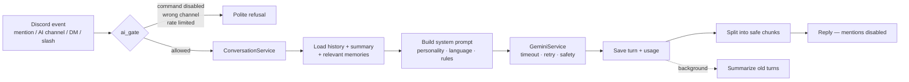

<div align="center">

# 🤖 Gemini Discord Bot

**A modular, security-minded Discord assistant powered by Google Gemini.**
Per-user conversations · user-controlled memory · per-server configuration · human-reviewed moderation · reliability built in.


[Quick Start](#-quick-start) · [Commands](#-command-reference) · [Configuration](#-configuration-reference) · [Architecture](#-architecture) · [Security](#-security-model) · [Troubleshooting](#-troubleshooting)

</div>

> **Status note:** this project was generated and compile-checked offline. The pure-logic parts (message splitting, rate limiter,
> moderation rules, sensitive-data filter, config validation) were exercised directly, but the code has **not yet been run against
> live Discord or Gemini**. Run `/ai_status` after your first start, and expect that a small SDK-version tweak may be needed.

---

## 📑 Table of Contents

1. [What is this?](#-what-is-this)
2. [Feature overview](#-feature-overview)
3. [Quick start](#-quick-start)
4. [Discord Developer Portal setup](#-discord-developer-portal-setup)
5. [Configuration reference](#-configuration-reference)
6. [Command reference](#-command-reference)
7. [How it works](#-how-it-works-in-depth)
8. [Architecture](#-architecture)
9. [Database](#-database)
10. [Security model](#-security-model)
11. [Privacy & data retention](#-privacy--data-retention)
12. [Reliability & performance](#-reliability--performance)
13. [Testing](#-testing)
14. [Deployment](#-deployment)
15. [Backups](#-backups)
16. [Troubleshooting](#-troubleshooting)
17. [Limitations & roadmap](#-limitations--roadmap)
18. [Contributing](#-contributing)

---

## ✨ What is this?

A production-oriented Discord bot that connects your server to the **Google Gemini API**. People can chat with it by mentioning it,
in dedicated AI channels, in DMs, or with slash commands. Server administrators control its personality, language, channels,
rate limits and moderation, entirely from Discord, with no code changes.

Design priorities, in order: **correctness → security & privacy → maintainability → features.**

## 🧩 Feature overview

| Area | What you get |
|---|---|
| **AI chat** | Mentions, AI-only channels, DMs, `!ask` prefix command, and slash commands. Follow-up questions understood via stored context. |
| **Isolated context** | Conversation history is stored **per server and per user**. Nobody's history mixes with anyone else's. |
| **Auto-summarizing** | When history grows too long, older turns are condensed into a short summary in the background. |
| **Long-term memory** | Users explicitly save non-sensitive facts/preferences; they can list, delete, or disable memory at any time. |
| **Personalities** | Friendly, Professional, Concise, Teacher, Creative, or a custom persona written by an admin. |
| **Multi-language** | Admin-set reply language, plus `/translate`. |
| **Moderation (optional)** | Spam, repeated-message, suspicious-link and prohibited-term detection → flagged to a log channel for **human review**. Warnings, escalating timeouts, appeals. |
| **Admin UX** | Embeds, a select menu, buttons, and a modal; every config change is audit-logged. |
| **Utilities** | Ping, help, user/server info, avatar, polls, personal reminders, server stats. |
| **Reliability** | Timeouts, bounded retries with exponential backoff, per-user & per-server rate limits, graceful shutdown. |
| **Privacy controls** | Retention windows, one-click "delete all server data", automatic purge when the bot is removed from a server. |
| **Safe output** | Long replies are split without breaking code blocks; AI output can never ping `@everyone`. |

---

## 🚀 Quick start

**Requirements:** Python 3.12+, a Discord bot token, and a Gemini API key.

```bash
# 1. Get the code
git clone <your-repo-url> gemini-discord-bot
cd gemini-discord-bot

# 2. Create a virtual environment and install dependencies
python3 -m venv .venv
source .venv/bin/activate            # Windows: .venv\Scripts\activate
pip install -r requirements.txt

# 3. Configure
cp .env.example .env                 # Windows: copy .env.example .env
# edit .env and fill in DISCORD_TOKEN, GEMINI_API_KEY, GEMINI_MODEL

# 4. Run
python bot.py                        # Windows: py bot.py
```

On success the log shows `Logged in as …` and `Synced N commands`. In Discord, try:

1. `/ai_status` — confirms Gemini is reachable.
2. `/ask question: What is a closure in JavaScript?`
3. `@YourBot explain recursion like I'm new to programming`
4. `/chat` twice — the second message should remember the first.

**Getting a Gemini API key:** create one in Google AI Studio (<https://aistudio.google.com/apikey>).
Pick a model from Google's current model list and set it in `GEMINI_MODEL`. The model name is deliberately **not hardcoded**,
because model availability and feature support change over time.

---

## 🛠 Discord Developer Portal setup

1. Open <https://discord.com/developers/applications> → **New Application**.
2. **Bot** tab → **Reset Token** → copy it into `.env` as `DISCORD_TOKEN`. Never share or commit it.
3. Under **Privileged Gateway Intents**:
   - ✅ **Message Content Intent**: *required* (needed to read mentions and AI-channel messages).
   - ☐ **Server Members Intent**: only if you want welcome messages. Also set `ENABLE_MEMBERS_INTENT=true`.
   - Presence Intent is **not** needed.
4. **OAuth2 → URL Generator**:
   - Scopes: `bot`, `applications.commands`
   - Bot permissions: View Channels, Send Messages, Send Messages in Threads, Embed Links, Read Message History, Add Reactions
   - Add **Moderate Members** only if you'll use timeouts.
5. Open the generated URL and add the bot to your server.

> The bot does **not** need Administrator or Manage Messages. It follows least privilege and never deletes messages.

### Slash-command sync

Commands sync automatically on startup (`SYNC_ON_START=true`).

- **While developing:** set `DEV_GUILD_ID` to your test server's ID for instant, guild-scoped commands.
  (Enable Developer Mode in Discord settings → right-click server → *Copy Server ID*.)
- **In production:** global commands can take up to an hour to appear. Once stable, set `SYNC_ON_START=false` to avoid
  re-syncing on every restart.

---

## ⚙️ Configuration reference

All configuration is via environment variables (loaded from `.env`). Values are **validated at startup**; the bot refuses to start
with a clear error if anything is missing or out of range.

### Required

| Variable | Description |
|---|---|
| `DISCORD_TOKEN` | Discord bot token. |
| `GEMINI_API_KEY` | Google Gemini API key. |
| `GEMINI_MODEL` | Gemini model name (verify it is available to your key). |

### Optional

| Variable | Default | Range | Description |
|---|---|---|---|
| `COMMAND_PREFIX` | `!` | | Prefix for text commands (`!ask`). Mentioning the bot also works as a prefix. |
| `LOG_LEVEL` | `INFO` | DEBUG–CRITICAL | Logging verbosity. |
| `LOG_DIR` | `logs` | | Folder for rotating logs (5 MB × 5 files). |
| `DATABASE_PATH` | `data/bot.db` | | SQLite file location (folder is created automatically). |
| `DEV_GUILD_ID` | *(empty)* | | Sync slash commands instantly to this server only. |
| `SYNC_ON_START` | `true` | | Sync slash commands on every start. |
| `ENABLE_MEMBERS_INTENT` | `false` | | Needed for welcome messages. Also enable it in the Developer Portal. |
| `GEMINI_TEMPERATURE` | `0.7` | 0–2 | Creativity of responses. |
| `GEMINI_TOP_P` | `0.95` | 0–1 | Nucleus sampling. |
| `GEMINI_MAX_OUTPUT_TOKENS` | `2048` | 64–65536 | Max reply length. Models that "think" spend some of this budget internally. |
| `GEMINI_TIMEOUT_SECONDS` | `45` | 5–300 | Per-request timeout. |
| `GEMINI_MAX_RETRIES` | `3` | 0–8 | Retries for transient errors. |
| `DEFAULT_HISTORY_LIMIT` | `20` | 4–100 | Starting history size for new servers. |
| `DEFAULT_USER_RATE_LIMIT_PER_MIN` | `6` | 1–120 | Starting per-user AI requests/minute for new servers. |
| `GUILD_RATE_LIMIT_PER_MIN` | `40` | 1–1000 | Total AI requests/minute per server. |
| `MAX_MEMORIES_PER_USER` | `50` | 1–500 | Memory slots per user per server. |
| `DEFAULT_RETENTION_DAYS` | `30` | 1–365 | Starting data-retention window for new servers. |

> The `DEFAULT_*` values only seed **new** servers. After that, admins change them per server with `/bot_config`.

---

## 📖 Command reference

### 🧠 AI commands

| Command | Description |
|---|---|
| `/ask question [style]` | One-off question with **no** conversation history. Style: Normal / Concise / Detailed. |
| `/chat message [style]` | Conversation that **remembers** earlier messages. |
| `/summarize [text] [recent_messages]` | Summarize pasted text (up to 6000 chars), **or** the last 5–50 messages in the current channel. Provide exactly one. For channel summaries you must be able to read that channel yourself. |
| `/translate text target_language` | Translate into any language. |
| `/explain topic [level]` | Explain at Beginner / Intermediate / Expert level, with an example. |
| `/code request [mode] [language]` | Generate or explain code. Code is **never executed** by the bot. |
| `/clear_memory` | Deletes *your* memories and conversation history **on this server** (or DMs). |
| `/ai_status` | Checks Gemini availability, shows the model, last success/error. Admins also see 24-hour usage for the server. |

### 🗂 Memory commands

| Command | Description |
|---|---|
| `/memory add text` | Save a short (≤300 chars) non-sensitive fact, e.g. "I prefer Python examples." |
| `/memory list` | Show what's saved, and whether memory is on. |
| `/memory delete memory_id` | Delete one memory. |
| `/memory toggle enabled` | Turn memory on/off for yourself. When off, nothing is retrieved or saved. |

### 🔧 Utility commands

| Command | Description |
|---|---|
| `/ping` | Bot latency. |
| `/help` | Auto-generated list of every command, grouped by module. |
| `/userinfo [member]` | Public info only: ID, account age, join date, top role, bot flag. |
| `/serverinfo` | Owner, creation date, member/channel/role counts. |
| `/avatar [user]` | Shows an avatar. |
| `/server_stats` | Members, channel counts, boost level, emoji count. |
| `/poll question options` | Poll with 2–5 options separated by `|`, voted via reactions. |
| `/remind when message` | Reminder for **yourself**. `when` like `30m`, `2h`, `1d` (10 seconds to 30 days). Max 25 pending. |
| `/reminders [cancel_id]` | List your pending reminders, or cancel one. |

### 🛡 Administration commands (require **Manage Server**)

| Command | Description |
|---|---|
| `/set_ai_channel channel [enabled] [restrict_ai]` | Make a channel an **AI channel** (the bot answers every message there). With `restrict_ai: True`, AI works **only** in those channels. |
| `/set_ai_personality personality [custom_description]` | Friendly, Professional, Concise, Teacher, Creative, or Custom (10–500 chars). |
| `/set_language language` | Preferred reply language, e.g. `Spanish`. |
| `/set_welcome_channel [channel]` | Enable welcome messages in a channel (omit the channel to disable). |
| `/set_welcome_message` | Opens a form. Placeholders: `{user}`, `{server}`, `{member_count}`. |
| `/set_moderation enabled [...]` | Configure moderation (see [Moderation](#-moderation)). |
| `/bot_config [history_limit] [user_rate_limit] [retention_days]` | Shows the full configuration embed. Includes a **select menu** to enable/disable individual AI commands and a **Delete all bot data** button (with confirmation). |

### 🔨 Moderation commands

| Command | Who | Description |
|---|---|---|
| `/mod_flags` | Moderators | List pending flagged messages. |
| `/mod_review flag_id action` | Moderators | Dismiss / Warn / Timeout (timeout asks for confirmation). |
| `/warnings member` | Moderators | A member's recent warnings and appeal status. |
| `/appeal warning_id reason` | The warned member | Contest a warning; it's posted to the log channel. |
| `/appeal_review warning_id decision` | Moderators | Accept or deny an appeal. Accepted warnings stop counting toward timeouts. |

### 💬 Other ways to talk to the bot

- `@Bot your question` anywhere it can read messages
- Any message in a configured **AI channel**
- Direct messages (uses default settings)
- `!ask your question` (prefix configurable)

---

## 🔍 How it works (in depth)

### 1. The AI chat pipeline



**`ai_gate`** runs before *every* AI entry point. It checks, in order: is the slash command enabled on this server, is AI restricted to certain
channels, and is the user within their rate limit.

**Prompt assembly** combines: base safety rules → the server's personality → reply language → optional answer-length hint →
the user's relevant memories → the conversation summary. User text is wrapped in `<user_content>` tags and the system prompt tells
the model to treat tagged content as **untrusted data**, not instructions.

### 2. Conversation history & summarization

- Stored per `(server, user)`. DMs use server ID `0`.
- The most recent **`history_limit`** messages are sent with each request.
- When stored messages exceed **2 × history_limit**, a background task asks Gemini to condense the oldest messages
  (together with any previous summary) into ≈150 words, saves it, and deletes those old rows. The summary is then included in future prompts.
- A per-user lock prevents two simultaneous messages from the same person corrupting their history.
- `/clear_memory` wipes history, summary and memories for the invoking user in that server.

### 3. Long-term memory

- **Opt-in by action:** memories only exist if a user runs `/memory add`. The bot does not silently harvest facts.
- **Sensitive-data filter:** rejects text that looks like passwords, API keys/tokens, private keys, card numbers, SSN-style numbers,
  e-mail addresses or phone numbers.
- **Retrieval:** keyword-overlap scoring picks up to 5 relevant memories per request (no embeddings; simple and dependency-free).
- **Scoping:** every query includes `guild_id` **and** `user_id`, so memories never cross servers or users.
- Limits: 300 characters each, `MAX_MEMORIES_PER_USER` per user per server.

### 4. 🛡 Moderation

Moderation is **off by default** and **rule-based**. AI is never used to decide punishment.

| Rule | Trigger |
|---|---|
| **Spam** | ≥ `spam_threshold` messages (default 6) within 8 seconds |
| **Repetition** | The same message 3+ times within 30 seconds |
| **Suspicious links** | URL shorteners, raw IP addresses, punycode look-alike domains, links with embedded credentials |
| **Prohibited terms** | Admin-defined whole-word list (up to 50 terms) |

Moderators (anyone with Manage Messages, Moderate Members, Manage Server, or Administrator) are **exempt**.

**What happens on a hit**

1. The message is recorded as a **flag** and posted to your log channel with **Dismiss / Warn / Timeout** buttons.
2. Depending on `auto_action`:
   - `flag` *(default)*: nothing else happens until a human reviews.
   - `warn`: the user is also automatically warned (and DM'd with their warning number and how to appeal).
3. If a user collects `warn_limit` warnings (default 3) within 24 hours, they're timed out for `timeout_minutes` (default 10).
4. **Timeouts clicked by a moderator require a confirmation prompt.** The bot refuses to act against moderators/admins and respects role hierarchy.
5. Every action is written to the audit log. The bot never deletes messages.

> Review buttons expire after 24 hours or a bot restart. Use `/mod_flags` + `/mod_review` after that.

### 5. Server personalization

Everything below is **per server**, stored in `guild_settings`: personality & custom persona, language, AI channels and restriction,
which AI commands are enabled, history limit, per-user rate limit, retention days, welcome channel/message, and all moderation settings.

### 6. Welcome messages

When enabled (and the Members intent is on), new members get your template with `{user}`, `{server}` and `{member_count}` replaced.
Only the joining member can be pinged.

### 7. Reminders

`/remind` stores a reminder that **you** scheduled and delivers it to the same channel (or by DM if the channel is gone) at the due time,
pinging only you. A background loop checks every 30 seconds; delivery is claimed atomically so a reminder never fires twice.

---

## 🏗 Architecture

```text
gemini-discord-bot/
├── bot.py                      Entry point: builds services, loads cogs, syncs commands, graceful shutdown
├── config.py                   Env loading + validation (secrets redacted from repr)
├── requirements.txt
├── .env.example                Placeholders only
├── .gitignore                  Excludes .env, data/, logs/
├── pytest.ini
├── database/
│   ├── db.py                   Async SQLite wrapper (execute / fetch / transaction / purge_guild)
│   └── schema.sql              All tables, created automatically on start
├── services/                   Business logic: no Discord code, easy to unit-test
│   ├── gemini_service.py       google-genai client, retries, timeouts, error mapping, safety settings
│   ├── conversation_service.py History, prompt building, summarization, usage tracking
│   ├── memory_service.py       User-approved memories + sensitive-data filter
│   ├── moderation_service.py   Detection rules, flags, warnings, appeals
│   ├── settings_service.py     Per-server settings, cache, audit log
│   └── rate_limit_service.py   Sliding-window limiter
├── cogs/                       Discord layer
│   ├── ai_chat.py              Mentions, AI channels, DMs, !ask
│   ├── ai_commands.py         AI slash commands + /memory group
│   ├── moderation.py           Detection listener, review buttons, warn/timeout/appeal commands
│   ├── utility.py              ping, help, info, poll, reminders
│   ├── administration.py       Config commands, select menu, modal, data-delete button
│   └── events.py               Guild join/leave, welcome, retention loop
├── utils/
│   ├── text.py                 Code-fence-safe message splitting, duration parsing
│   ├── guards.py               ai_gate (enabled? allowed channel? rate limit?)
│   ├── permissions.py          Admin/moderator checks
│   ├── views.py                Confirmation buttons
│   ├── embeds.py               Consistent embed styles
│   ├── personalities.py        Built-in personalities
│   └── logging_config.py       Rotating logs with secret redaction
└── tests/
```

**Layering rule:** cogs talk to Discord; services talk to the database and Gemini. Services never import `discord`, which keeps them testable
and makes it possible to reuse them from a future web dashboard.

**Wiring:** `GeminiBot` (in `bot.py`) creates one instance of each service and attaches it to the bot
(`bot.convo`, `bot.gemini`, `bot.memory_svc`, `bot.mod_svc`, `bot.settings_svc`, `bot.limiter`, `bot.db`). Cogs read them from `self.bot`.
Cogs are loaded with `load_extension`; if any fails the bot **fails fast** rather than running half-loaded.

---

## 🗄 Database

SQLite (WAL mode) is created and migrated-by-`IF NOT EXISTS` automatically at startup from `database/schema.sql`.
A single connection with a write lock keeps writes serialized, and multi-step changes use real transactions with rollback.

| Table | Purpose |
|---|---|
| `guild_settings` | One row per server (ID `0` = DMs) with all configuration. |
| `conversations` | Chat turns per `(guild_id, user_id)`. |
| `conversation_summaries` | Condensed older context. |
| `memories` | User-approved memories. |
| `user_prefs` | Per-user memory on/off switch. |
| `flagged_messages` | Moderation flags and their review status. |
| `warnings` | Warnings, with appeal text and status. |
| `audit_log` | Who changed which setting / took which moderation action. |
| `reminders` | Scheduled reminders. |
| `usage` | Token counts per request (when the API reports them). |

Database access is confined to the small `Database` class, so moving to PostgreSQL later means replacing that class and porting
a few SQL details (placeholders, `AUTOINCREMENT`, `INSERT OR IGNORE`). It is **not** a drop-in swap, but it's contained.

---

## 🔐 Security model

| Concern | How it's handled |
|---|---|
| **Secrets** | Only via environment variables; `.env` is git-ignored; `.env.example` has placeholders only; config `repr` is redacted; logs scrub Google keys, Discord tokens and `key=value` secrets. |
| **Prompt injection** | User text, memories and summaries are delimited and declared untrusted. The model has **no tools** and cannot take actions, so injected instructions have nothing to hijack. |
| **No AI-driven admin actions** | Moderation actions come only from fixed rules + human clicks. No model output ever triggers a ban, timeout, or setting change. |
| **No code execution** | AI-generated code and shell commands are never run. |
| **Least privilege** | Minimal intents (Message Content required; Members optional), no Presence intent, no Administrator, no message deletion. |
| **Authorization** | Admin commands need Manage Server (checked at runtime *and* hidden via default permissions). Moderation needs moderator permissions. Channel summaries require the invoking user's own read access. |
| **Mention safety** | `AllowedMentions.none()` is the bot-wide default; AI replies can't ping `@everyone`/roles. Reminders and welcomes ping only the intended user. |
| **Input validation** | Length limits on every argument, duration parsing, language-name pattern check, option counts for polls. |
| **Isolation** | Every history and memory query is scoped by server **and** user. |
| **Confirmations** | Timeouts and "delete all data" require an explicit confirm. |
| **Audit** | Config changes and moderation actions are recorded in `audit_log`. |

---

## 🗑 Privacy & data retention

**What is stored:** server settings; chat history and summaries; memories users explicitly saved; moderation flags (with a ≤300-char excerpt) and
warnings; reminders; audit entries; token-usage counts.

**Retention (runs every 6 hours):**
- Conversations and memories older than the server's `retention_days` are deleted.
- Usage and audit entries older than 90 days are deleted.
- Completed reminders older than 7 days are deleted.

**User controls:** `/clear_memory`, `/memory delete`, `/memory toggle`.
**Admin controls:** `/bot_config retention_days`, and the **Delete all bot data** button.
**Server removal:** when the bot is kicked/removed from a server, that server's data is purged automatically.

> Backups taken before a deletion still contain the old data until they age out. Keep backup retention short.
> Message Content access means the bot *can* see messages in channels it can read; it only processes messages that mention it,
> are in AI channels, are DMs, or (if moderation is on) need rule checks. Tell your community accordingly.

---

## ⚡ Reliability & performance

- **Fully async.** Discord and Gemini calls never block the event loop.
- **Timeouts.** Every Gemini call is wrapped in `GEMINI_TIMEOUT_SECONDS`.
- **Bounded retries with exponential backoff + jitter** (`min(30s, 2^attempt + random)`) for transient failures: timeouts, HTTP 429, 5xx, network errors.
  Permanent errors (400/401/403/404) are *not* retried and show an "AI misconfigured" message.
- **Friendly errors.** Rate limits, outages, timeouts, safety blocks and misconfiguration each map to a clear user-facing message; raw errors stay in the logs.
- **Deferred interactions.** Slash commands defer immediately so slow generations never hit Discord's 3-second window.
- **Rate limiting.** Sliding 60-second windows per user (configurable per server) and per server. Rejected requests aren't counted.
- **Safety settings.** Harassment, hate speech, sexually explicit and dangerous-content categories are set to block at medium-and-above.
- **Safe splitting.** Replies over ~1900 characters are split on line boundaries; split code blocks are closed and re-opened with the same language tag.
- **Graceful shutdown.** Background summaries are cancelled, the Gemini client and database are closed.
- **Duplicate-handler safety.** Prefix commands are detected with `get_context(...).valid` so a command and the chat listener never both answer.
- **Structured logging.** Rotating files (5 MB × 5), secrets redacted, noisy libraries quieted.

---

## 🧪 Testing

```bash
pip install -r requirements.txt
pytest
```

| File | Covers |
|---|---|
| `tests/test_rate_limits.py` | Window expiry, per-user vs per-server limits, override, blocked calls not counted. |
| `tests/test_permissions.py` | Admin/moderator detection, command check rejects non-admins and DMs. |
| `tests/test_ai_service.py` | Gemini retry/backoff, bounded retries, no retry on config errors, blocked responses, config validation, message splitting with code fences, duration parsing, sensitive-data filter, URL rules, moderation rules. Uses a fake client, **no network or API key needed**. |
| `tests/test_database_integration.py` | Settings defaults/updates, memory isolation across servers and users, memory limits, full guild purge, using in-memory SQLite. |

**Manual integration checklist** (in a private test server with `DEV_GUILD_ID` set):

- [ ] `/ai_status` shows reachable
- [ ] `/chat` follow-up remembers context; `/ask` does not
- [ ] `/memory add` → mention the bot with a related question → memory is used
- [ ] `/memory add "my password is x"` is refused
- [ ] `/set_ai_channel` then chat there without mentioning the bot
- [ ] `/set_moderation enabled:True log_channel:#mod-log` then trigger a link-shortener flag and use the buttons
- [ ] `/clear_memory` empties both memory and history

---

## 🚢 Deployment

### systemd (Linux)

```ini
# /etc/systemd/system/geminibot.service
[Unit]
Description=Gemini Discord Bot
After=network-online.target

[Service]
Type=simple
User=geminibot
WorkingDirectory=/opt/gemini-discord-bot
ExecStart=/opt/gemini-discord-bot/.venv/bin/python bot.py
Restart=on-failure
RestartSec=5
NoNewPrivileges=true

[Install]
WantedBy=multi-user.target
```

```bash
sudo systemctl daemon-reload
sudo systemctl enable --now geminibot
journalctl -u geminibot -f
```

### Production checklist

- [ ] `.env` is not in git; file permissions restricted (`chmod 600 .env`)
- [ ] Runs as a dedicated non-root user
- [ ] `data/` is on persistent storage, access-restricted, and backed up
- [ ] Only the required intents and permissions are granted
- [ ] `SYNC_ON_START=false` after commands are stable
- [ ] Gemini quota/billing alerts set in Google Cloud
- [ ] Rate limits and retention reviewed per server
- [ ] Restart-on-failure configured
- [ ] Single instance only (the rate limiter and SQLite are per-process)

---

## 💾 Backups

**Simplest:** stop the bot, copy the whole `data/` folder, start the bot again. Restore by replacing `data/` with your copy.

**While running** (consistent snapshot; the bot uses WAL mode, so don't copy only the `.db` file):

```bash
sqlite3 data/bot.db ".backup 'backups/bot-$(date +%F).db'"
```

Keep a separate, private copy of `.env`. Treat backups as sensitive; they contain conversations and memories.

---

## 🩺 Troubleshooting

| Symptom | Likely cause / fix |
|---|---|
| `Configuration error: Missing required environment variables` | `.env` missing or incomplete. Fill `DISCORD_TOKEN`, `GEMINI_API_KEY`, `GEMINI_MODEL`. |
| `PrivilegedIntentsRequired` / bot ignores mentions | Enable **Message Content Intent** in the Developer Portal. |
| Slash commands don't appear | Wait for global sync (up to 1 hour) or set `DEV_GUILD_ID`. Confirm the invite included `applications.commands`. |
| "The AI is misconfigured" | Wrong `GEMINI_MODEL` or API key (HTTP 400/401/403/404). Check `logs/bot.log` and `/ai_status`. |
| "Too many requests / quota" | Gemini free-tier or quota limits. Lower traffic or raise quota. |
| Empty or "blocked" answers | Safety filters, or `GEMINI_MAX_OUTPUT_TOKENS` too low for a model that reasons internally. Raise it. |
| "You're sending requests too quickly" | Per-user limit. Admins can raise it with `/bot_config user_rate_limit`. |
| "AI features are limited to #channel" | `restrict_ai` is on. Use the AI channel or turn it off with `/set_ai_channel … restrict_ai:False`. |
| Timeout action fails | Bot lacks **Moderate Members**, or its top role is not above the target's. |
| Welcome messages don't send | Enable the Members intent in the portal **and** `ENABLE_MEMBERS_INTENT=true`; make sure the bot can send in that channel. |
| Moderation flags aren't posted | Set a `log_channel` and make sure the bot can send messages there. |
| `database is locked` | Run only one bot process against the same database file. |
| Review buttons stopped working | They expire after 24 h / restart. Use `/mod_review`. |

Increase detail with `LOG_LEVEL=DEBUG` and read `logs/bot.log`.

---

## 🧭 Limitations & roadmap

**Implemented limits worth knowing**
- Moderation review buttons are not persistent across restarts.
- Memory retrieval is keyword-based, not semantic.
- Single-process only (in-memory rate limiter, SQLite).
- Moderation rules are heuristics and can have false positives; tune thresholds and keep human review on.
- Welcome messages need the privileged Members intent.

**Designed for, but not built yet**
- 📚 RAG / server FAQ generation from admin-approved documents
- 🖼 Image and file understanding (model-dependent)
- 📤 Conversation export with user authorization
- 📣 Scheduled announcements
- 🎭 Per-user custom personas
- 🌐 Web dashboard API
- 💰 Cost estimation (token counts are recorded; pricing is not)
- 🐘 PostgreSQL backend

---

## 🤝 Contributing

1. Fork and create a feature branch.
2. Keep Discord code in `cogs/` and logic in `services/`.
3. Add or update tests; run `pytest`.
4. Never commit `.env`, tokens, or database files.
5. Open a pull request describing the change and how you tested it.

Add a `LICENSE` file of your choice before publishing.

---

<div align="center">

Built with **discord.py** and the **Google Gemini API**.

</div>
